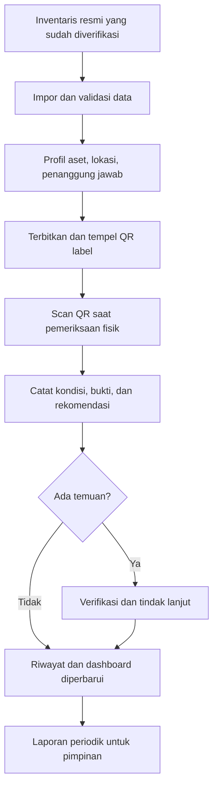

# Konsep Inovasi: SATRIA BMN

## Identitas

**Nama:** SATRIA BMN — *Sistem Aset Terintegrasi untuk Registrasi, Inventarisasi, dan Analitik Barang Milik Negara*.

**Tagline:** *“Tertib Aset, Cepat Tindak Lanjut.”*

**Posisi produk:** aplikasi internal Bidang Pembinaan Kejaksaan Negeri Indragiri Hulu untuk membantu operasi inventaris BMN, aset, dan perlengkapan. SATRIA BMN menjadi lapisan operasional pelengkap atas pencatatan yang sah; bukan pengganti sistem BMN nasional atau proses administrasi resmi.

**Arah branding:** resmi, rapi, akuntabel, dan praktis. Prototipe menggunakan hijau institusi, emas, putih, dan abu gelap. Tanda grafis memadukan perisai, huruf S, dan grid QR; penggunaan lambang resmi Kejaksaan perlu mengikuti pedoman identitas instansi.

## Masalah yang ditangani

- Pencarian aset, lokasi, dan penanggung jawab masih dapat memerlukan rekap manual.
- Kondisi fisik dan data inventaris berisiko tidak diperbarui pada waktu yang sama.
- Temuan kerusakan, mutasi, atau aset tidak ditemukan sulit dimonitor sampai selesai.
- Laporan per ruang atau per kondisi dapat memerlukan kompilasi berulang.

## Tujuan

1. Mempercepat pencarian, pemeriksaan, dan pelaporan BMN/perlengkapan.
2. Menjaga kesesuaian antara data, lokasi, penanggung jawab, dan kondisi aktual aset.
3. Memastikan temuan memiliki tindak lanjut serta jejak aktivitas yang dapat diperiksa.
4. Menyediakan pola implementasi yang dapat dikonfigurasi ulang oleh Kejari lain.

## Fitur inti

| Modul | Fungsi operasional |
|---|---|
| Dashboard | Metrik jumlah/nilai aset, kondisi, pemeriksaan jatuh tempo, sebaran ruangan, dan temuan prioritas. |
| Inventaris BMN | Pencatatan kode barang, NUP, nama, kategori, nilai, lokasi, penanggung jawab, kondisi, dan keterangan aset. |
| QR aset | QR Code token internal untuk membuka profil aset secara cepat dari komputer atau ponsel. |
| Monitoring kondisi | Pemeriksaan berkala dengan status Baik, Rusak Ringan, Rusak Berat, atau Tidak Ditemukan, beserta catatan dan rekomendasi. |
| Riwayat dan audit | Jejak aktivitas perubahan data dan riwayat pemeriksaan aset. |
| Impor data | Template CSV, pratinjau, pemeriksaan kolom wajib, dan pencegahan duplikasi. |
| Laporan | Rekap inventaris, kondisi, ruangan, dan aset bermasalah; ekspor CSV serta cetak/PDF. |

## Alur kerja target

## Peran target

- **Administrator/Pengurus Barang:** data master, impor, penerbitan QR, laporan, cadangan data.
- **Operator unit/ruangan:** scan QR dan menyampaikan hasil pemeriksaan.
- **Verifikator/Kasubbag Pembinaan:** memeriksa perubahan penting, menetapkan tindak lanjut, dan memantau progres.
- **Pimpinan:** dashboard serta laporan baca-saja.
- **Auditor internal:** akses baca terbatas ke inventaris dan jejak audit.

## Indikator keberhasilan pilot

- Minimal 95% aset memiliki lokasi dan penanggung jawab terisi.
- 100% aset aktif yang telah diverifikasi memiliki label QR.
- Waktu pencarian aset dan penyusunan laporan turun dibanding proses manual awal.
- Persentase pemeriksaan sesuai jadwal meningkat dari baseline yang disepakati.
- Selisih lokasi/kondisi antara data dan pemeriksaan fisik menurun tiap periode.
- Persentase tindak lanjut temuan selesai tepat waktu meningkat.
- Setiap perubahan penting menyimpan pelaku, waktu, alasan, dan riwayat sebelum/sesudah pada lingkungan produksi.

## Prinsip replikasi

- Identitas satuan kerja, kode satker, kategori, lokasi, template laporan, dan pengguna harus disimpan sebagai konfigurasi, bukan ditanam dalam kode.
- Tiap Kejari menggunakan basis data dan akun terpisah.
- Paket implementasi memuat template impor, kamus data, panduan peran, konfigurasi awal, backup, dan prosedur pemulihan.
- Integrasi ke sistem resmi hanya dilaksanakan setelah ada persetujuan tata kelola, keamanan, serta mekanisme pertukaran data yang sah.
